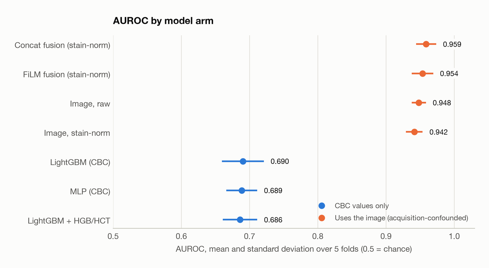
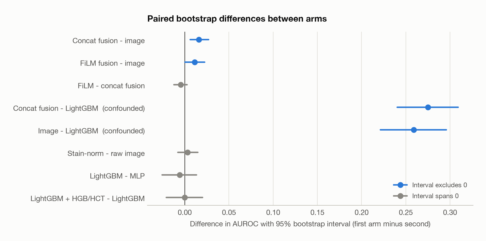
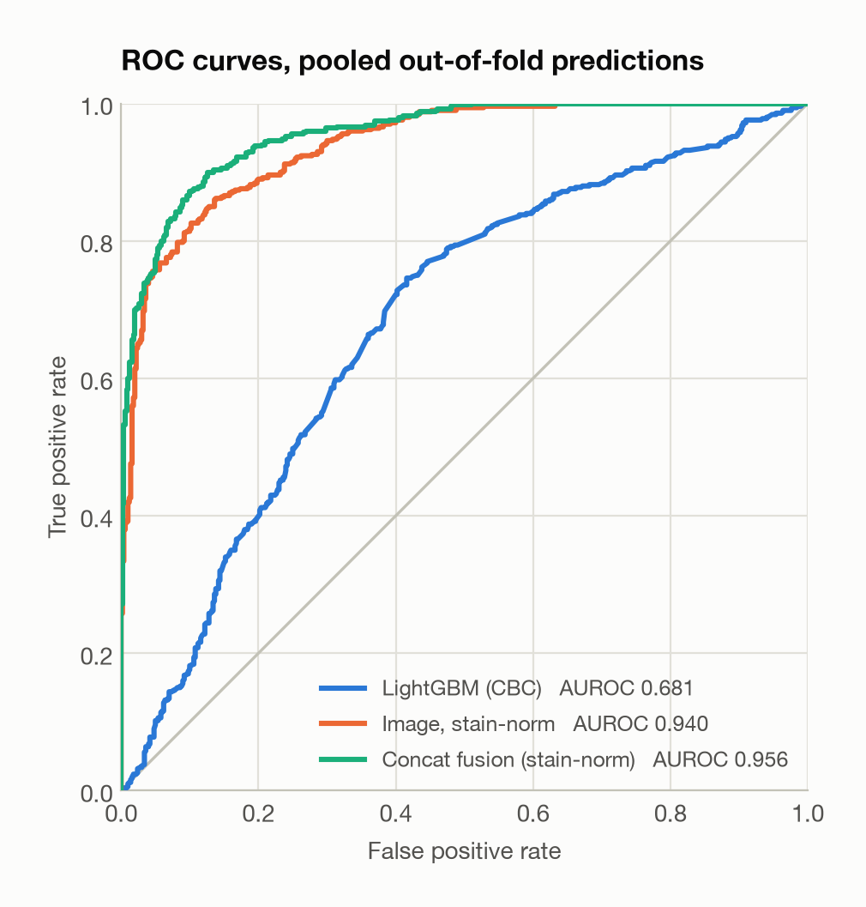
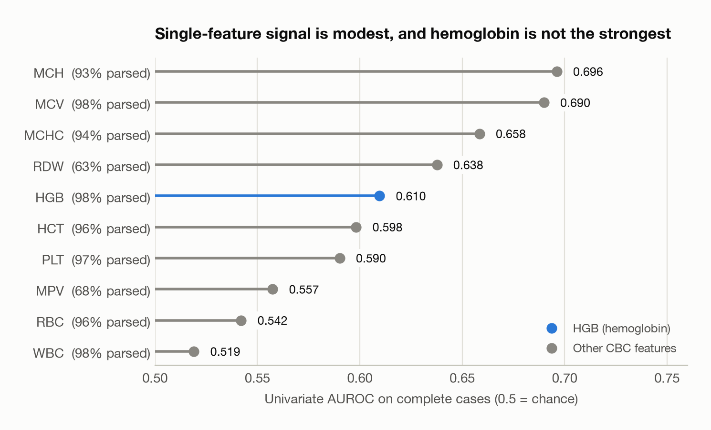
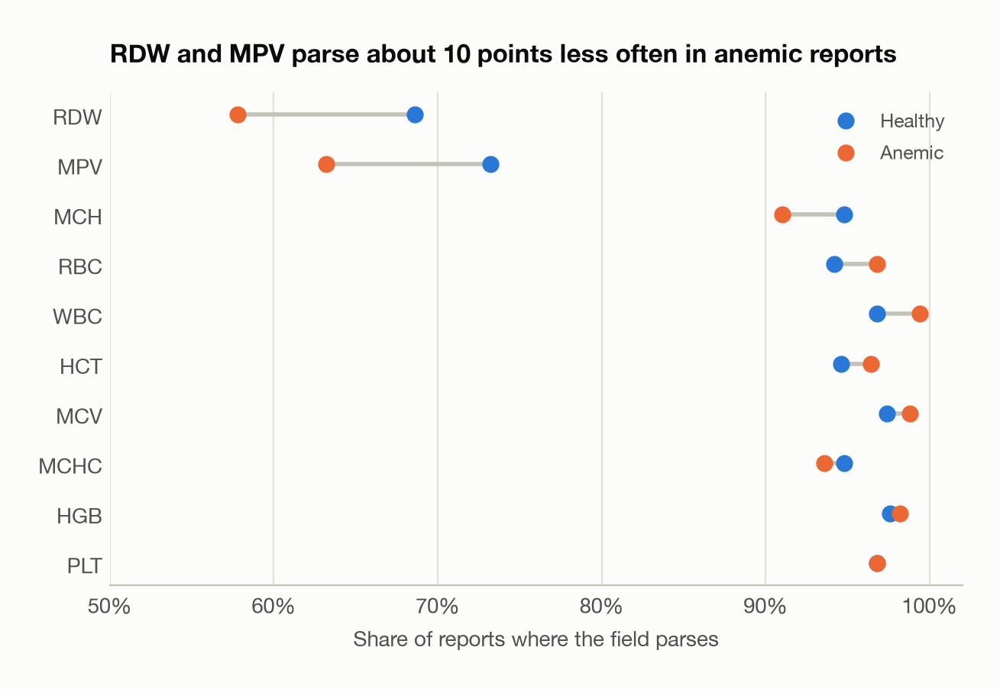

# anemic-blood-ml


Does the appearance of red blood cells (the smear image) add predictive signal over standard blood-count values for anemia classification, and the other way around? This project compares four model arms under a leakage-safe, statistically careful protocol, and uncovers a staining artifact that makes the naive image result misleading.

> **Read the acquisition-artifact finding before quoting any image-arm number.** On this public dataset, blank slide background alone predicts the diagnosis at 0.87 AUROC.

**Contents:** [Overview](#project-overview) · [Getting started](#getting-started) · [Objectives](#objectives-and-goals) · [Methodology](#methodology) · [Results](#results-and-key-findings) · [Visualizations](#visualizations) · [Next steps](#next-steps) · [Contributions](#individual-contributions) · [Leakage traps](#leakage-traps) · [Data and license](#data-and-license) · [Layout](#repository-layout)

## Project overview

- **Data:** the public AneRBC dataset (Shahzad et al., 2024): 1000 blood smear images, 500 healthy and 500 anemic, each with a complete blood count (CBC) report.
- **Task:** binary classification, anemic versus healthy, one prediction per patient.
- **Four arms:** a strong tabular model, a fair tabular model, an image-only model, and fusion models that use both.
- **Status:** complete. All arms are trained and compared.
- **Headline results:**
  - CBC values alone reach about 0.69 AUROC, and that is an honest ceiling.
  - Image arms reach 0.94 to 0.96 AUROC, but the gap is largely an acquisition artifact and not a morphology result.
  - The one defensible image-involving number is the small gain from adding CBC values to the image model: +0.016 AUROC, 95% interval [+0.006, +0.027].

## Getting started

Everything below works straight after cloning. The parsed table, the folds and every arm's out-of-fold predictions are committed in `artifacts/`, so you do not need the 7.5 GB image dataset for the tabular arms, the notebooks or the evaluation.

### 1. Set up locally

```bash
git clone https://github.com/matchalatte2609/anemic-blood-ml.git
cd anemic-blood-ml

python -m venv .venv
source .venv/bin/activate              # Windows: .venv\Scripts\activate
pip install -r requirements-dev.txt    # pinned runtime packages, Jupyter and pytest

pytest                                 # all tests pass in a few seconds
```

Requires Python 3.11 or newer (developed on 3.11, install and tests verified on 3.12).

### 2. Train a model

```bash
python -m src.train --arm lgbm         # LightGBM on CBC values, about 3 seconds
python -m src.train --arm mlp          # MLP on CBC values, about 7 seconds on Apple Silicon
```

Both tabular arms reproduced the committed predictions exactly when re-run on Apple Silicon. Training **overwrites** `artifacts/preds/<arm>.csv`. Undo with `git checkout artifacts/preds/`.

The image and fusion arms (`--arm image`, `concat`, `film`, with `--stain-norm`) need the dataset and a GPU. See the [user guide](docs/user-guide.md#3-get-the-dataset-image-arms-only). The author measured about 25 minutes per image arm on Apple Silicon.

### 3. Evaluate performance

```bash
python -m src.train --summary          # AUROC, AUPRC, ECE for every saved arm
python -m src.train --compare concat_stainnorm image_stainnorm
```

The second command prints the paired bootstrap difference between two arms:

```
concat_stainnorm - image_stainnorm: delta=+0.0159 95% CI [+0.0061, +0.0269] -- significant
```

For a guided walk-through with figures, run the notebooks in `notebooks/`. The full instructions are in the [user guide](docs/user-guide.md).

## Objectives and goals

**Research question.** Does RBC morphology (image) add predictive signal over CBC indices (tabular) for anemia classification, and does the CBC add signal over the image?

**Goals**

1. **A fair comparison.** Give the tabular side a strong model (LightGBM) and a matched deep model (MLP), so that a fusion gain cannot come from a weak baseline.
2. **No leakage.** Group the splits by patient, fit every imputer and scaler on training rows only, and keep the pathologist's report text out of the features.
3. **Honest uncertainty.** Report the difference between arms with a paired bootstrap interval, not only a table of scores.
4. **Surface confounds.** Test whether a surprisingly good result is measuring something other than the biology.
5. **Reproducibility.** Make every reported number checkable from files in the repository.

## Methodology

**Data preparation.** The CBC reports are OCR text with at least seven kinds of corruption (shifted columns, mangled field names, missing commas, impossible values such as an RDW of 396). The parser anchors each number on its unit, normalizes field names, and discards values outside a plausible range. It adds no missing-value indicator columns. Each report becomes one row, joined to its image.

**Splits.** `StratifiedGroupKFold` with 5 folds and seed 42. The group key is `{id}_{class}`, because `001_h` and `001_a` are different patients. Folds are built once, stored on disk and shared by every arm.

**Model arms**

| Arm | Input | Model |
|---|---|---|
| `lgbm` | 8 CBC values, raw NaNs | LightGBM, heavily regularized (7 leaves, learning rate 0.03, up to 500 trees with early stopping) |
| `mlp` | 8 CBC values, imputed and standardized | 2-layer MLP, hidden size 64, dropout 0.3 |
| `image` | Smear image resized to 384 x 384 | ImageNet-pretrained ResNet18 (`timm`), flips, 90-degree rotations and mild color jitter |
| `concat` | Image and CBC values | Image embedding and tabular embedding, each projected to 64 dimensions, concatenated, MLP head |
| `film` | Image and CBC values | CBC values scale and shift the ResNet's final feature map (FiLM, zero-initialized so it starts as the image model) |

**Fairness rules enforced in code**

- Imputation and standardization are fitted on the training rows of each fold only.
- Early stopping watches an inner split of the training rows, never the outer fold.
- All deep arms use one shared training loop with identical settings (up to 25 epochs, AdamW, learning rate 3e-4, patience 6).
- Each fold is seeded with `seed + fold`.

**Evaluation.** AUROC, AUPRC and expected calibration error (ECE), as mean and standard deviation over the 5 folds. Differences between arms use a paired bootstrap: resample patient groups 2000 times, score both arms on each resample, and take the 2.5th and 97.5th percentiles. An interval that excludes zero is the result.

## Results and key findings

Out-of-fold performance, 5 folds, mean and standard deviation:

| Arm | AUROC | AUPRC | ECE | Trustworthy as a morphology result? |
|---|---|---|---|---|
| Concat fusion (stain-norm) | **0.959 ± 0.015** | 0.962 ± 0.013 | 0.070 | No, confounded |
| FiLM fusion (stain-norm) | 0.954 ± 0.016 | 0.951 ± 0.022 | 0.077 | No, confounded |
| Image, raw | 0.948 ± 0.010 | 0.946 ± 0.015 | 0.095 | No, artifact |
| Image, stain-norm | 0.942 ± 0.012 | 0.946 ± 0.014 | 0.078 | No, artifact |
| LightGBM (CBC) | 0.690 ± 0.031 | 0.636 ± 0.036 | 0.097 | Yes |
| MLP (CBC) | 0.689 ± 0.023 | 0.648 ± 0.030 | 0.097 | Yes |
| LightGBM + HGB/HCT | 0.686 ± 0.025 | 0.644 ± 0.034 | 0.106 | Yes |

Paired bootstrap differences (2000 resamples, grouped by patient, first arm minus second):

| Comparison | Difference | 95% interval | Reading |
|---|---|---|---|
| concat - image | +0.016 | [+0.006, +0.027] | Significant. The one defensible image-involving number. |
| FiLM - image | +0.011 | [+0.000, +0.023] | Significant, marginally |
| FiLM - concat | -0.005 | [-0.012, +0.003] | No difference |
| concat - LightGBM | +0.275 | [+0.240, +0.309] | Significant but confounded |
| image - LightGBM | +0.259 | [+0.221, +0.296] | Significant but confounded |
| stain-norm - raw image | +0.003 | [-0.008, +0.015] | No effect |
| LightGBM - MLP | -0.006 | [-0.026, +0.013] | No difference |
| LightGBM + HGB/HCT - LightGBM | -0.000 | [-0.021, +0.020] | No effect |

**Key findings**

1. **The label is a morphology call, not a hemoglobin threshold.** Hemoglobin ranks only fifth of ten features, and adding it to the model changes AUROC by -0.000 (interval [-0.021, +0.020]). Of "healthy" samples, 52% have hemoglobin below 12 g/dL.
2. **About 0.69 AUROC is the honest tabular ceiling.** The three red-cell indices (MCV, MCH, MCHC) carry nearly all the signal, and they are derived from the same underlying measurements.
3. **The tabular baseline was not crippled.** LightGBM and the MLP are statistically indistinguishable, so a fusion gain cannot be dismissed as a weak tabular branch.
4. **The image result is confounded by acquisition.** Six numbers per image (channel means and standard deviations, no cells and no spatial information) predict the label at 0.905 AUROC. The same statistics over background pixels only, which contain no cells, reach 0.833. After per-image standardization, background-only statistics still reach 0.872. Healthy and anemic slides were evidently captured in systematically different sessions.
5. **Some real signal survives.** A stain-invariant measure of how pale cells are relative to the background predicts at 0.734, in the expected direction (anemic cells are paler), which is about on par with the CBC.
6. **Which fields a report contains leaks the label.** RDW is missing noticeably more often in anemic reports, and the flag "RDW is missing" alone scores 0.554 AUROC when recomputed from the committed table. This is why the pipeline imputes without missing-value indicator columns.

**What can and cannot be re-checked here.** Every number in the two tables above, the hemoglobin ranking and the 52% figure in finding 1, the LightGBM and MLP baselines, and the missingness result in finding 6 are recomputed from committed files by the notebooks. Two sets of numbers are reported from the author's own runs instead. The feature-subset ablation behind finding 2 is not reproduced by a notebook. The image-artifact probes in findings 4 and 5 were run on the full 7.5 GB image set, and their code is not in this repository. See the [research notes](docs/research-notes.md) for the full log.

## Visualizations

All figures are generated by the notebooks from the committed artifacts, in a light and a dark version.

<picture>
  <source media="(prefers-color-scheme: dark)" srcset="docs/figures/arm-auroc-dark.png">
  
</picture>

*AUROC by arm. Orange arms use the image and are acquisition-confounded.*

<picture>
  <source media="(prefers-color-scheme: dark)" srcset="docs/figures/paired-deltas-dark.png">
  
</picture>

*Paired bootstrap differences. The two large gaps against LightGBM are the confounded ones.*

<picture>
  <source media="(prefers-color-scheme: dark)" srcset="docs/figures/roc-curves-dark.png">
  
</picture>

*ROC curves from pooled out-of-fold predictions. Pooled AUROCs differ slightly from the fold averages in the table.*

<picture>
  <source media="(prefers-color-scheme: dark)" srcset="docs/figures/univariate-auroc-dark.png">
  
</picture>

*Single-feature signal. Hemoglobin is not the strongest.*

<picture>
  <source media="(prefers-color-scheme: dark)" srcset="docs/figures/missingness-dark.png">
  
</picture>

*RDW and MPV parse about 10 points less often in anemic reports.*

## Next steps

In rough order of value:

1. **A defensible image arm.** Train on `RGB_segmented` (background masked out entirely), then try per-cell color normalization. Validate by checking that the background and artifact baselines drop to chance before reporting any headline number.
2. **Ship the artifact probes.** Add the color, background-only and sharpness probe code so finding 4 can be re-checked from a clean checkout.
3. **Use the 12 crops per patient.** Implement `pool_crop_embeddings` to mean-pool AneRBC-II crops up to one vector per patient. Keep folds at the patient level.
4. **Report sex as a covariate.** The inferred sex is confounded with the class. Report models with and without it.
5. **Auxiliary target.** Use the morphology report text only as a secondary multi-label target or for error analysis, never as a feature.

## Individual contributions

This is a solo project by Khang "Tom" Nguyen. I built the pipeline end to end:

- the CBC report parser, its coverage audit and the audit of seven OCR corruption modes
- the master table, the patient-grouped folds and the group-leak assertion
- the five model arms and the shared training loop
- the metrics and the paired group bootstrap
- the leakage analysis, including the differential-missingness and staining-artifact findings
- the notebooks, tests, figures and documentation in this repository

The dataset is the work of its authors, credited below.

## Leakage traps

The pipeline is built around four traps. Details and measurements are in the [research notes](docs/research-notes.md).

1. **Morphology reports are the label in prose.** Never use their text as a feature.
2. **Split by patient group.** The group key is `{id}_{class}`, not the number alone.
3. **Differential missingness.** Which fields a report contains differs by class. Impute without missing-value indicators.
4. **Staining and acquisition artifact.** Empty slide background predicts the diagnosis, so naive image scores are inflated.

## Data and license

The images and report text are **not** in this repository (7.5 GB). A 100-row CSV of parsed CBC values is in [`data/sample/`](data/sample/README.md), with a column dictionary. The full parsed table is `artifacts/master.parquet`.

**Dataset:** Shahzad, M., Shirazi, S. H., Yaqoob, M., Khan, Z., Rasheed, A., Sheikh, I. A., Hayat, A., and Zhou, H. (2024). *AneRBC dataset: a benchmark dataset for computer-aided anemia diagnosis using RBC images.* Database, 2024, baae120. [doi.org/10.1093/database/baae120](https://doi.org/10.1093/database/baae120). Hosted on Mendeley Data at [doi.org/10.17632/hms3sjzt7f.1](https://doi.org/10.17632/hms3sjzt7f.1) under CC BY 4.0.

**Code license:** MIT. See [LICENSE](LICENSE). This project is for research and education and is not for clinical use.

## Repository layout

```
src/                   the library (see docs/api.md)
  config.py            paths, constants, feature lists
  parse_cbc.py         OCR'd CBC reports to tidy rows
  build_dataset.py     master table and CBCImputer
  splits.py            grouped stratified folds and the leak check
  metrics.py           AUROC, AUPRC, ECE, paired group bootstrap
  data.py              image cache, transforms, loaders
  models/              tabular, image, fusion, shared training loop
  train.py             arm runner and command line
notebooks/             01 CBC exploration, 02 results and comparisons
docs/                  user-guide.md, api.md, research-notes.md, figures/
data/sample/           100-row CSV sample and its data dictionary
artifacts/             parsed table, folds, out-of-fold predictions
scripts/make_sample.py rebuilds the sample from the parsed table
tests/                 fast tests, no dataset needed
```

**Documentation:** [User guide](docs/user-guide.md) · [API reference](docs/api.md) · [Research notes](docs/research-notes.md)
